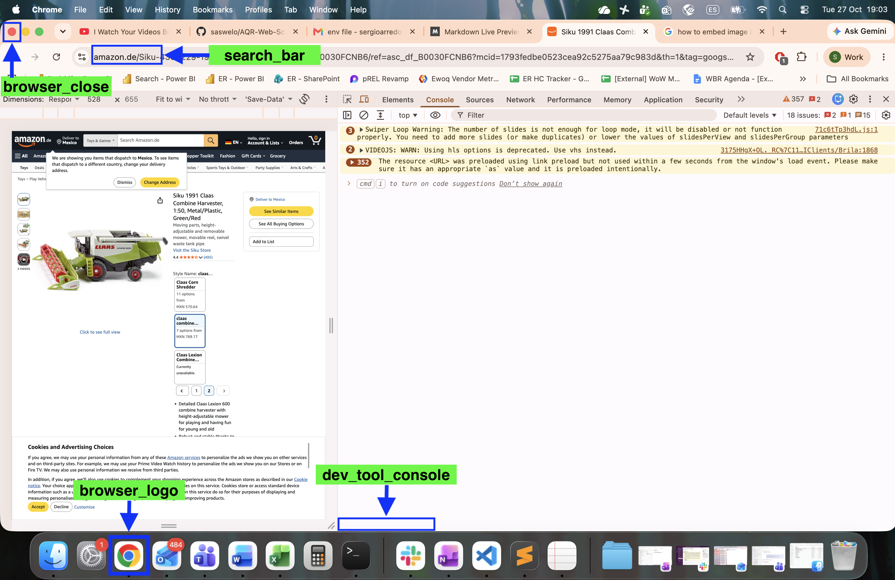

# AQR Landing Page (website) Scrape Bot

This repository contains two sripts that implement the process of scraping landing pages of ER (Expert Raters) AQR evals:

- **prepare_raw_data.ipynb:** Loads two spreadsheet files, one of them containing AQR evals content (query, ad title, landing page) and the other individual ER raters ratings to evals that have been audited by SERs. This script pairs evals content with their type of ad (Shopping or Text ad), ER agreement rate with the SER rating, and a binary flag indicating whether a majority of the ERs agree with the SER rating.

- **webscrap_bot.py:** Loads a spreadsheet file (produced by the **prepare_raw_data.ipynb** script), takes each of the evals' landing page URL and scrapes their website content as markdown-formatted text. This script takes control over the keyboard and mouse to open landing pages directly through a web browser's UI, therefore, it is necessary to grant the console application control permissions.

## Installing Python Dependencies
Run the following command to install the dependencies needed to run both scripts:

1. ```conda create --name scraper_env python=3.9```
2. ```conda activate scraper_env```
3. ```pip install -r requirements.txt```

## System Dependencies
Since **webscrap_bot.py** script takes control over the keyboard and mouse to open landing pages directly through a web browser's UI, therefore, it is necessary to grant the console application control permissions.

## Data Dependencies
- The **prepare_raw_data.ipynb** assumes two spreadsheet files exist in the local directory: **AQR_2026_ER_SER.xlsx** (i.e. contains ER-SER data) and **AQR eval content.xlsx** (contains content of evals). The values of these files can be changed in the script to match your specific inputs.
- Before running the web-scraping process, you must update the screen coordinates of your browser logo (in your desktop or dock), the search bar in your browser after its opened, your browser's close/exit button, and the bottom of the dev tools console within your browser. See the **Get Screen Coordinates** section for more information on how to run this process.

## Run Process
Both processes assume you have installed and activated the anaconda environment as specified in the **Installing Dependencies** section.

### I. Get Screen Coordinates
1. Open your browser
2. Within your browser open the devs tool UI
3. Within the devs tool UI, click on the "console tab"
4. In your local console, run the following command in the project folder: ```python webscrap_bot.py screen_coord.json -s```. This command will instruct the script to recollect the screen corrdinates needed to web-scrap landing pages content.
5. For each one of the coordinates, you must position your mouse on top of the location (without clicking) of the keyword being prompted by the script and press "Enter" once. See the reference image below for an example of what each keyword should be mapped to.



### II. Run Data Preparation Script
You can run the **prepare_raw_data.ipynb** script from any coding IDE that support jupyter notes (i.e. **.ipynb** files), for example Visual Code. Make sure before you run the script you select the ```scraper_env``` conda environment as the kernel.

### III. Run Scraping Script
Execute the shell script running the following command: ```bash run.sh```.

**NOTE:** While the scraping script is running, you should not move (or touch) your mouse as this could compromise the bot's precision. Also, in case you have multiple language settings for your keyboard, it is imperative that before you run the scraping script the keyboard language is set to its original language.